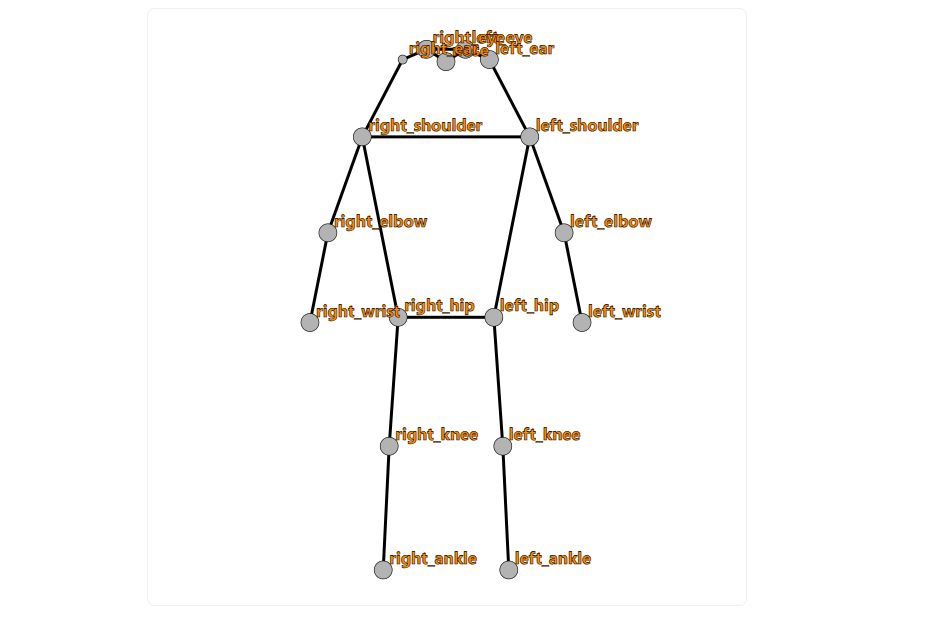
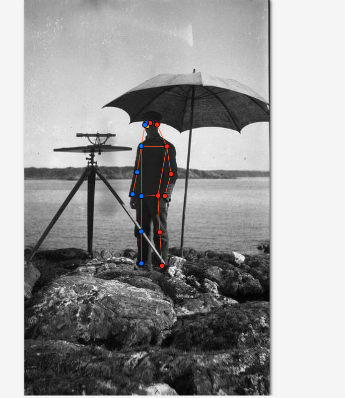
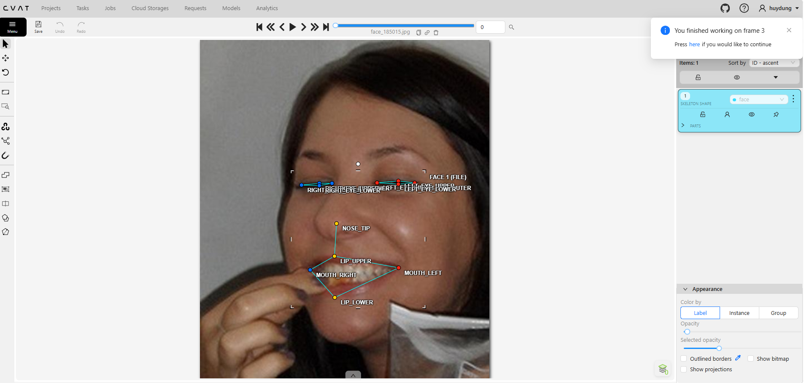
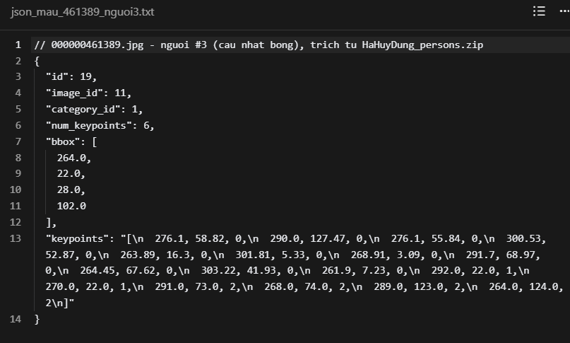

# Báo cáo cá nhân — HaHuyDung-2A202603271

Dữ liệu: 12 ảnh người COCO 2017 (Lin et al., 2014) và 8 ảnh khuôn mặt cắt từ ảnh COCO 2017 (CC BY / CC BY-SA), chỉ dùng trong lớp.

## 0. Thông tin học viên

- Họ tên: Hà Huy Dũng
- MSSV: 2A202603271
- Email: 26ai.dunghh@vinuni.edu.vn
- Link repository: https://github.com/hdung25/K5-L2B-HaHuyDung-2A202603271-KeypointPose-Student
- Phiên bản CVAT (Help → About): 2.74.1 (`python lab.py check` báo `CVAT 2.74.1 tại http://localhost:8080`)
- Máy: hệ điều hành Windows 11 Home · Docker được dùng 7.6 GB RAM · chạy CVAT chế độ đầy đủ
- Bộ ảnh (`src/exports/assignment.json` do `lab.py setup` tạo): có
- Giờ bắt đầu: 4h20 PM
- Giờ kết thúc: 5h40 PM

Bộ ảnh theo MSSV (pool `d04-k5-v2`):

| Nhóm | Ảnh |
|---|---|
| `easy` | 000000057978, 000000103970, 000000176000, 000000201702, 000000292999 |
| `occluded` | 000000156986, 000000461389, 000000521817 |
| `back` | 000000391222, 000000461002 |
| `small` | 000000167027 |
| `crowd` | 000000309169 |
| `faces` | thẳng: 362568, 380639, 469647 · nghiêng: 185015, 416730 · kính trong: 288853 · kính râm: 256814 · tóc che: 333134 |

## 1. Kiểm tra label (CP0)

| Label | Kiểu | Số điểm | Tên điểm đúng bảng của lab? | Đúng thứ tự? | Số cạnh |
|---|---|---:|---|---|---:|
| `person` | Skeleton | 17 | Có | Có (nose → right_ankle) | 19 |
| `face` | Skeleton | 13 | Có | Có (left_eye_outer → lip_lower) | 13 |

Mẫu `person` dựng theo người quay mặt về camera (các điểm `left_*` nằm bên phải khung mẫu)? Có

Cách đổi cờ `occluded` / `outside` cho **một điểm** trên phiên bản CVAT này (một câu):

Rê chuột vào đúng điểm đó cho sáng lên rồi bấm `Q` (occluded, `v = 1`) hoặc `O` (outside, `v = 0`), hoặc chuột phải vào điểm để chọn trong menu 4 nút; chỉ điểm đó đổi, các điểm khác giữ nguyên. Không dùng `H` (hidden).

## 2. Số lượng đã gán và thời gian (CP1, CP2)

| Nhóm ảnh | Số ảnh | Số skeleton đã gán | Số người dưới 60 px (không gán) | Số poster / gương / màn hình bỏ qua | Thời gian (phút) |
|---|---:|---:|---:|---:|---:|
| `easy` | 5 | 5 | 3 (người trượt tuyết rất nhỏ ở nền ảnh 176000) | 1 khung ảnh treo tường có 2 người (201702) | 10 |
| `occluded` | 3 | 7 | 0 | 0 | 10 |
| `back` | 2 | 4 | 0 | 0 (tấm biển thông tin ở 391222 không có người) | 11 |
| `small` | 1 | 2 | khoảng 8 (thực khách ngồi sau lan can và sau kính, cao ~30–50 px) | 0 | 11 |
| `crowd` | 1 | 3 | 2 (hai người đứng xa bên trái) | 0 | 13 |
| `faces` | 8 | 8 | — | 0 | 11 |

Tổng: 21 skeleton `person`, 8 skeleton `face`.

- Số ảnh người đã xong ở mốc phút 105: 10 / 10

- Ảnh tốn thời gian nhất là ảnh nào, vì sao?

  `000000309169` (crowd): hai cô gái chồng lên nhau khi bắt đĩa. Một bàn tay giơ lên sau lưng cô áo vàng dễ bị gán nhầm cho cô áo vàng. Phải lần theo chi từ vai cô áo đen để thấy đó là cổ tay **trái** của cô áo đen; tay phải của cô áo vàng khuất hẳn sau thân nên để `outside`. Tiếp theo là `000000461389`: cậu nhặt bóng chỉ thấy từ hông xuống (thân trên ra ngoài mép trên), phải tự đặt hông, gối, cổ chân.

## 3. Bảng ca khó (CP1, CP2)

| Ảnh | Người / mặt | Điểm | Cờ đã chọn | Phân vân giữa | Lý do chọn |
|---|---|---|---:|---|---|
| 309169 | #2 cô áo vàng (nghiêng, nhìn sang trái ảnh) | `right_wrist`, `right_elbow` | 0 | 1 / 0 | Tay phải ở phía xa, khuất sau thân. Bàn tay thấy được sau lưng cô là của cô áo đen. Không ước lượng chắc → `outside` |
| 309169 | #3 cô áo đen | `left_wrist` | 2 | gán cho #2 hay #3 | Lần theo vai → khuỷu của cô áo đen thì bàn tay giơ sau lưng cô áo vàng thuộc về cô áo đen |
| 461389 | #3 cậu nhặt bóng | `left_hip`, `right_hip` | 1 | 1 / 0 | Hông nằm dưới quần đùi, sát mép trên. Ước lượng được từ đùi và gối nên `occluded`. Toàn bộ thân trên, tay, đầu ra ngoài ảnh → `outside` |
| 461389 | #2 trọng tài biên | mũi, mắt, tai | 0 | — | Đầu bị mép trên cắt mất: ngoài ảnh → `outside`, không kéo về mép |
| 167027 | #1 người đi bộ sát mép trái | `left_shoulder`, `left_elbow`, `left_wrist` | 0 | 1 / 0 | Quay lưng, tay trái nằm ngoài mép trái ảnh. `left_hip` để 1 vì hông còn trong ảnh, sát mép |
| 167027 | #1, #2 (quay lưng) | mũi, hai mắt | 0 | 1 / 0 | Chỉ thấy gáy, không đoán chắc vị trí mặt |
| 201702 | #1 | `left_ankle`, `right_ankle` | 0 | 2 / 0 | Ống quần chạm mép dưới, không thấy giày. Cổ chân thật ở ngoài ảnh → `outside` |
| 461002 | #1 cậu bé quay lưng | `right_ankle` | 0 | 2 / 0 | Bàn chân phải bị mép dưới cắt |
| 461002 | #1 | `left_wrist` | 0 | 1 / 0 | Tay trái gập ra trước bụng, không thấy, ước lượng tản mát |
| 391222 | #1 quay lưng, ngoái đầu sang phải | `nose` | 1 | 2 / 1 / 0 | Chỉ thấy đường viền má và mũi, mũi ước lượng được; hai mắt `outside` |
| 391222 | #2 nghiêng nhìn trái ảnh, đeo kính râm | `left_eye` | 1 | 2 / 1 | Mắt sau kính râm tối → `occluded` như quy tắc kính râm; mắt và tai phải ở phía xa → `outside` |
| 176000 | #1 trượt ván tuyết | hai mắt, hai tai | 1 | 2 / 1 | Mắt sau kính trượt tuyết, tai dưới mũ len: ước lượng chắc |
| 156986 | #2 người trượt ván (nhìn từ sau, cúi đầu sang trái ảnh) | `right_eye`, `right_ear` | 0 | 1 / 0 | Chỉ thấy nửa mặt bên trái (phía gần camera) |
| 156986 | #1 cậu đứng sau | chân phải, cổ chân | 1 | 1 / 0 | Bị chân người trượt ván che một phần, vẫn lần được từ đùi |
| 521817 | #2 người ngồi | `left_knee`, hai cổ chân | 0 | 1 / 0 | Chân xếp bằng, ra ngoài mép dưới |
| 292999 | #1 cầu thủ bóng chày | `left_elbow`, `left_shoulder` | 1 | 1 / 0 | Tay trái khuất sau tay phải đang cầm gậy, ước lượng từ hai bàn tay trên cán gậy |
| face_256814 | kính râm | 8 điểm mắt | 1 | 2 / 1 | Kính râm tối (ảnh màu) → `occluded`, đặt theo vị trí mắt sau tròng kính |
| face_380639 | mặt thẳng, mắt gần nhắm | mí trên / mí dưới | 2 | 2 / 1 | Mắt nhắm vẫn thấy đường mí, hai điểm mí nằm sát nhau trên đường mí, mí trên ở trên |
| face_185015 | mặt nghiêng, ngón tay ở miệng | `mouth_right` | 2 | 2 / 1 | Ngón tay sát khóe miệng phải nhưng khóe vẫn thấy |

## 4. Bảng tự review (CP3)

Đi từ ảnh cuối về ảnh đầu: 5 ảnh người (2 `back` và 1 `crowd`) và 3 ảnh mặt. Ghi lỗi trước, sửa sau. Lỗi được tìm khi so lớp nhãn nháp (pre-annotation do model đặt, xem mục 9) với ảnh phóng to.

| Ảnh | Người / mặt | Điểm | Mã lỗi | Ghi chú | Đã sửa? |
|---|---|---|---|---|---|
| 521817 (occluded) | #1 cậu bé ngoái đầu | toàn người | `ok` | Thân quay lưng (vai trái bên trái ảnh), đầu ngoái qua vai phải nên mắt trái nằm bên phải ảnh. Script cảnh báo cặp eye/ear ngược phía: tư thế thật, giữ nguyên | — |
| 521817 | #2 người ngồi | `left_knee`, `left_ankle`, `right_ankle` | `vis_flag` | Nháp để `v = 2` sát mép dưới, khớp thật ở ngoài ảnh | Có → `outside` |
| 461389 (occluded) | #3 cậu nhặt bóng | hông, gối | `position` | Nháp đặt hông ở gấu quần đùi và gối trùng chỗ hông | Có, đặt lại hông (v=1), gối, cổ chân |
| 461389 | #3 | đầu, vai, tay | `vis_flag` | Nháp có điểm ở mép trên, thân trên thật ở ngoài ảnh | Có → `outside` |
| 461389 | #2 trọng tài | mũi, mắt, tai | `vis_flag` | Đầu ra ngoài mép trên | Có → `outside` |
| 461002 (back) | #1 cậu bé quay lưng | `nose`, `left_eye`, `right_eye` | `vis_flag` | Quay lưng, không thấy mặt mà nháp để `v = 2` | Có → `outside` |
| 461002 | #1 | `right_ankle` | `vis_flag` | Nằm ở y = 478 / 480, bị mép dưới cắt | Có → `outside` |
| 461002 | #2 cậu bé thả diều | chân | `ok` | Script cảnh báo knee/ankle ngược phía: chân bắt chéo thật khi đang chạy | — |
| 391222 (back) | #1, #2 | mắt, tai phía xa | `vis_flag` | Nháp để `v = 2` cho mắt người quay lưng / mắt phía xa | Có → 0 hoặc 1 (xem mục 3) |
| 391222 | #1, #2 | trái/phải | `ok` | #1 quay lưng: `left_*` bên trái ảnh. #2 nghiêng nhìn trái ảnh: bên gần camera là bên trái. Đúng | — |
| 309169 (crowd) | #2 cô áo vàng | `right_wrist` | `vis_flag` | Nháp gán bàn tay của cô áo đen cho cô áo vàng | Có → `outside` |
| 309169 | #3 cô áo đen | `left_wrist` | `position` | Nháp đặt lệch ~65 px so với bàn tay thật | Có, đặt vào bàn tay giơ sau lưng cô áo vàng |
| 309169 | #1 người chạy | chân | `ok` | Chân bắt chéo thật khi chạy | — |
| 156986 (occluded) | #2 người trượt ván | `right_eye`, `right_ear` | `vis_flag` | Script cảnh báo "thấy rõ mũi và hai mắt nhưng left bên trái ảnh". Thật ra nhìn từ phía sau, chỉ thấy nửa mặt trái | Có → `outside`, hết cảnh báo |
| face_380639 | mặt thẳng | `*_eye_upper` / `*_eye_lower` | `position` | Mắt gần nhắm, mí trên nằm dưới mí dưới (script cảnh báo) | Có, đặt hai điểm trên đường mí, mí trên ở trên |
| face_333134 | tóc che | `right_eye_outer` | `position` | Khóe ngoài mắt phải lệch lên đuôi lông mày | Có |
| face_256814 | kính râm | 8 điểm mắt | `vis_flag` | Nháp để `v = 2` sau kính râm tối | Có → `occluded` |
| face_185015 | mặt nghiêng | `nose_tip` | `position` | Nháp đặt ở cánh mũi trái, không ở chóp mũi | Có |

Tổng hợp số lỗi theo mã:

| `lr_swap` | `vis_flag` | `position` | `missing` | `extra` | `ok` |
|---:|---:|---:|---:|---:|---:|
| 0 | 9 | 5 | 0 | 0 | 4 |

Điểm còn phân vân giữa `v = 1` và `v = 0` (ghi cả hai lựa chọn và lý do chọn):

- 167027 #1 `left_hip`: chọn `v = 1`, không chọn `v = 0`. Hông nằm cách mép trái ~3 px, vẫn trong ảnh, ước lượng được từ đùi trái. Vai trái rộng hơn hông nên vai đã ra ngoài khung (`v = 0`).
- 461389 #3 hai hông: chọn `v = 1`, không chọn `v = 0`. Đùi và gối thấy rõ, chiều dài đùi ≈ cẳng chân nên hông ước lượng chắc dù bị quần che và sát mép trên.
- 309169 #2 `right_elbow`: chọn `v = 0`, không chọn `v = 1`. Không thấy đoạn chi nào của tay phải; ba người đoán sẽ ra ba chỗ khác nhau.

## 5. Kiểm file xuất và kết quả tự kiểm (CP4)

Tự kiểm tay trong file JSON (`annotations/person_keypoints_default.json` trong zip; zip chỉ có file này, không kèm ảnh):

| File | Người / mặt kiểm (ảnh, thứ tự) | Số phần tử `keypoints` | Điểm `outside` ra `v = 0`, `occluded` ra `v = 1`? | `num_keypoints` khớp? |
|---|---|---:|---|---|
| `HaHuyDung_persons.zip` | 461389, người #3 (cậu nhặt bóng, annotation id 19) | 51 | Có: `v` = `[0,0,0,0,0,0,0,0,0,0,0,1,1,2,2,2,2]`. 11 điểm thân trên `outside` ra 0, 2 hông `occluded` ra 1 | Có: `num_keypoints` = 6 = số điểm `v > 0` |
| `HaHuyDung_persons.zip` | 461002, người #1 (quay lưng, annotation id 15) | 51 | Có: mũi, 2 mắt, cổ tay trái, cổ chân phải ra `v = 0`; mũi vẫn mang tọa độ cũ `(155.38, 154.56, 0)` | Có: 12 = 12 |
| `HaHuyDung_faces.zip` | face_256814 (kính râm, annotation id 2) | 39 | Có: 8 điểm mắt `occluded` ra `v = 1`, 5 điểm mũi/miệng `v = 2` | Có: 13 = 13 |

Sau khi xuất, CVAT ghi `occluded` thành `v = 1` và `outside` thành `v = 0`. Tọa độ của điểm `outside` trong file là `0, 0` hay tọa độ cũ? Tọa độ cũ (CVAT 2.x giữ nguyên; script ghi chú, không tính là lỗi).

Hai job đã chuyển sang completed trên CVAT? Có (Menu → Finish the job; job 11 `persons-HaHuyDung` và job 12 `faces-HaHuyDung` đều `state = completed`)

Dán phần **TÓM TẮT** in ra từ `src/check_submission.py`:

```text
----- TÓM TẮT (dán vào báo cáo mục 5) -----
- File person: HaHuyDung_persons.zip
  Số ảnh: 12 · số skeleton `person`: 21 · mỗi annotation 51 số
  Skeleton theo ảnh: 000000057978=1, 000000103970=1, 000000156986=2, 000000167027=2, 000000176000=1, 000000201702=1, 000000292999=1, 000000309169=3, 000000391222=2, 000000461002=2, 000000461389=3, 000000521817=2
  Cờ v: v=2 271 (76%) · v=1 36 (10%) · v=0 50 (14%)
  num_keypoints trung bình: 14.6
- File face: HaHuyDung_faces.zip
  Số ảnh: 8 · số skeleton `face`: 8 · mỗi annotation 39 số
  Skeleton theo ảnh: face_185015=1, face_256814=1, face_288853=1, face_333134=1, face_362568=1, face_380639=1, face_416730=1, face_469647=1
  Cờ v: v=2 96 (92%) · v=1 8 (8%) · v=0 0 (0%)
  num_keypoints trung bình: 13.0
- Ghi chú: 50 điểm v = 0 vẫn mang tọa độ cũ (CVAT 2.x xuất như vậy; chuẩn COCO ghi 0, 0). Không phải lỗi: điểm v = 0 bị bỏ qua khi huấn luyện và khi chấm.
- Số [LỖI]: 0 · số [CẢNH BÁO]: 4
Kết quả: ĐẠT (đọc lại từng cảnh báo ở trên)
```

Các `[CẢNH BÁO]` còn giữ nguyên và lý do (đã kiểm từng người bằng mắt):

- `000000292999 #1`: cặp elbow ngược phía. Tay thật bắt chéo: tay phải vắt qua ngực cầm gậy, khuỷu phải nằm bên phải ảnh, khuỷu trái khuất sau (`v = 1`).
- `000000309169 #1`: cặp knee, ankle ngược phía. Người đang chạy, chân trái đạp sau, gối phải đưa trước: chân bắt chéo thật.
- `000000461002 #2`: cặp knee, ankle ngược phía. Cậu bé đang chạy kéo diều, chân bắt chéo thật.
- `000000521817 #1`: cặp eye, ear ngược phía so với thân. Thân quay lưng, đầu ngoái qua vai phải nhìn camera: tư thế thật, không phải `lr_swap`.

## 6. Ảnh chụp màn hình

 chụp trên CVAT và lưu đúng tên vào `report/individual/images/`.

1. Label `person` trong label constructor (đủ 17 điểm có tên):

   

2. Một người quay lưng đã gán, cờ đã đặt (gợi ý: 461002 #1 hoặc 391222 #1):

   

3. Một khuôn mặt đã gán 13 điểm, phóng to vùng mắt (gợi ý: face_256814 kính râm hoặc face_416730):

   

4. Một đoạn JSON xuất của một người:

   

Nguồn ảnh: COCO 2017.

## 7. Tự đánh giá

1. Lỗi bạn mắc nhiều nhất hôm nay, và cách bạn sẽ tránh ở dự án thật:

   Lỗi nhiều nhất là `vis_flag`: nhãn nháp từ model để `v = 2` cho gần như mọi điểm. Mắt của người quay lưng, mắt/tai phía xa của người nghiêng, khớp bị mép ảnh cắt đều bị để `v = 2`, vì độ tin cậy của model pose (ViTPose 0,8–1,0) không cho biết điểm có bị che hay không. Cách tránh: không dùng score của model làm cờ visibility. Với mỗi người, nói hướng người rồi đi hết bốn câu hỏi cho từng điểm; riêng các điểm cách mép dưới 3 px thì kiểm "khớp thật có trong ảnh không".

2. Một quy tắc bạn đề xuất thêm vào guideline (kèm ảnh ví dụ nếu có):

   "Bàn tay nằm giữa hai người chồng nhau: lần từ vai → khuỷu → cổ tay của từng người. Nếu không lần được liên tục thì cổ tay đó `outside` với người còn lại, không được gán một bàn tay cho hai skeleton." Ví dụ: 309169, bàn tay giơ sau lưng cô áo vàng là của cô áo đen.

3. Nhãn của bạn đi vào model ở đâu? Chọn một lỗi bạn đã sửa và nói nó sẽ làm model học sai thế nào (heatmap, trọng số trong loss, hay bước lật ảnh):

   Lỗi `vis_flag` ở 461002 #1 (mũi và hai mắt của cậu bé quay lưng để `v = 2` ở vùng tóc sau gáy). Nếu không sửa, ba điểm đó có trọng số 1 trong loss và sinh ba đỉnh heatmap "mũi / mắt" trên tóc gáy. Model học rằng mặt có thể nằm ở sau đầu, và với ảnh quay lưng nó sẽ tự tin dự đoán mắt trên tóc. Khi lật ảnh, cặp `left_eye` ↔ `right_eye` sai đó còn được nhân đôi. Sửa thành `v = 0` thì loss bỏ qua các điểm này.

## 8. Khó khăn và lỗi kỹ thuật

- Docker Desktop chưa chạy lúc đầu; bật Docker Desktop rồi `python lab.py check`. Check báo OPA chưa nạp quy tắc và tự khởi động lại `cvat_opa` (đã nạp 445 quy tắc).
- Bản CVAT trên máy là 2.74.1, tài liệu viết theo 2.82; phím `Q` / `O` và menu chuột phải vẫn như cheatsheet.
- Ảnh `small` (167027): hai người cao ~82–86 px, một người sát mép trái. Phải phóng to 6 lần mới phân biệt được tay trái đã ra ngoài khung.

## Bonus (nếu làm)

Không làm B1/B2. (B3: xem mục 9, đã dùng model pose làm pre-annotation và so với nhãn sau review.)

### B3 — Model so với nhãn của tôi (không tính điểm)

- Model đã dùng: YOLO11m-pose, ViTPose-base (COCO 17 điểm), MediaPipe Face Landmarker (478 điểm)
- Ảnh đã thử: cả 12 ảnh người và 8 ảnh mặt

1. Model có trả điểm cho khớp bị che, hay khớp ngoài ảnh không? Confidence ở các điểm đó thế nào?

   Có. ViTPose luôn trả đủ 17 điểm, kể cả mắt của người quay lưng (461002 #1: score mắt 0,5–0,7) và đầu bị mép trên cắt (461389 #2: score 0,6). Score của điểm bị che thường vẫn 0,8–0,9, nên không dùng được làm cờ `v`. Chỉ khi cả nửa thân ra ngoài ảnh (461389 #3) score mới rơi về 0–0,2.

2. Với người quay lưng, model có đổi trái/phải không?

   Không. ViTPose đặt đúng `left_*` bên trái ảnh cho cả 4 người quay lưng (391222 #1, 461002 #1, 167027 #1 #2). Nó cũng xử lý đúng ca thân quay lưng nhưng đầu ngoái lại (521817 #1), ca mà script tự kiểm lại cảnh báo.

3. Bộ điểm của model có giống 17 điểm COCO không?

   YOLO11-pose và ViTPose dùng đúng 17 điểm COCO, cùng thứ tự. MediaPipe Face có 478 điểm, phải tự chọn ra 13 điểm của lab. Mí trên / mí dưới được nội suy trên đường viền mí tại hoành độ tâm con ngươi (iris).

## 9. Tài liệu tham khảo và công cụ AI đã dùng

- Tài liệu lab: `docs/GUIDELINE.md`, `docs/CVAT_CHEATSHEET.md`, `docs/COCO_KEYPOINTS.md`.
- Model pretrained công khai, chạy CPU, dùng để tạo **nhãn nháp** (pre-annotation) rồi import vào CVAT định dạng "CVAT 1.1". Không dùng annotation COCO gốc.
  - YOLO11m-pose (Ultralytics, COCO-pose): tìm người và khung bao.
  - ViTPose-base (`usyd-community/vitpose-base-simple`, Hugging Face): 17 điểm top-down trên từng khung người.
  - MediaPipe Face Landmarker (Google, ~3,6 MB): 478 điểm mặt, ánh xạ sang 13 điểm của lab.
- Mọi cờ `v`, trái/phải, quyết định gán / không gán (dưới 60 px, khung ảnh treo tường) và các điểm sửa tay đều được review bằng mắt trên ảnh phóng to theo GUIDELINE mục 4, ghi ở mục 3–4. File xuất do CVAT tạo qua `python lab.py export`, không sửa JSON bằng tay.

